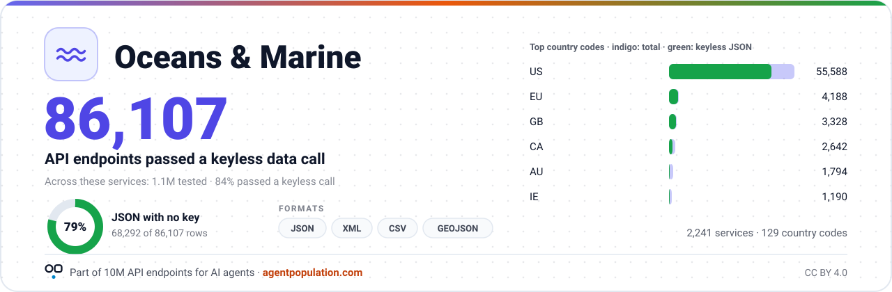
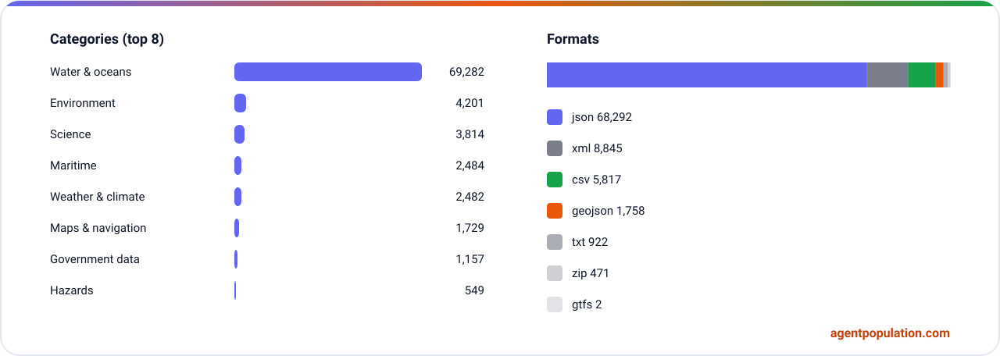

<p align="center"></p>

# 🐋 Ocean and marine API endpoints

**86,107 ocean and marine API endpoints that answered a keyless GET with a data body. For agent and app builders.**

<p align="center"><a href="#files"></a> <a href="#columns-and-tags"></a> <a href="#whats-inside"></a> <a href="#whats-inside"></a> <a href="LICENSE"></a></p>

<p align="center"><a href="#whats-in-it-for-you">What's in it</a> · <a href="#for-ai-agents">For AI agents</a> · <a href="#quick-start">Quick start</a> · <a href="#test-it-yourself">Test it yourself</a> · <a href="#files">Files</a> · <a href="#licence-and-credit">Licence</a> · <a href="#part-of-10m-api-endpoints-for-ai-agents">More packs</a></p>

This repository holds a 1,000-row sample and the services list; the full list of 86,107 endpoints is one download from the [latest release](https://github.com/agentpopulation/86k-oceans-apis-for-agents/releases/latest).

**Endpoints for building a sea-state, buoy or marine-data tool.** Ocean and coastal datasets on ERDDAP servers (sensors, gliders, cruises, satellite grids), sea level gauges, NDBC buoy reports, Swedish sea temperature and sea level stations, and marine map layers such as protected areas and sea level rise, as URLs that answered with no key on their test date.

Selection rule: rows where `tags has oceans`, less the rows that a leave-out rule drops (each counted under Known limits).

39,850 of these 86,107 rows match the focus rule (below); the others are in the pack by the selection rule only, and Known limits says what they are.

## In plain words

**What is an API endpoint?** An API endpoint is one web address that a program can ask for data, for example the latest reading at one weather station. A single service, such as a national weather agency, can have thousands of endpoints: one per station, city or dataset. This pack counts endpoints, not separate services.

**What does "passed a data call" mean?** On the date shown in each row, AgentPopulation sent one plain request to that address, with no password or key, and got a non-empty data body back (JSON, CSV, XML or a file): not an error page and not an empty result. Some bodies describe a dataset rather than hold its values; see Known limits. It shows the address answered with data on that day. It is not a promise that it answers today, and licences and usage limits were not reviewed.

## What's in it for you

Four ways to use this pack. Each bucket gives a count, a filter you can apply to the CSV, one example that passed, and a list of recommended starting points with the rule that picked them. Buckets overlap; a row can fit more than one.

Examples, recommended lists and the preview are drawn from rows that match this pack's focus rule, so a row that the selection rule put in this pack but that is about something else is not shown as a starting point. Counts cover the whole bucket.

<details>
<summary>The focus rule</summary>

Focus rule: `(title matches /ocean|\bseas?\b|seawater|sea[- ]?(level|surface|ice|floor|bed|grass)|marine|coast|\btides?\b|tidal|\bwaves?\b|buoy|bathym|salin|current|glider|\bargo\b|\bctd\b|reef|coral|plankton|benth|estuar|gulf|cruise|underway|offshore|mooring|kelp|whale|dolphin|porpoise|turtle|shore|lighthouse|\bhav|meer|\bmer\b|\bzee\b|\bmar\b|oceanograph/i OR subcategory matches /glider/i) AND NOT title matches /\bocean (county|city|township|grove|park|beach|springs|shores|drive|ridge|view|pines)|oceanside|oceanville|ocean to ocean/i AND NOT title matches /airport|air force base|raws_|reservoir|above sea level|über meer|ü\. ?m\.|lake bathym|river bathym|tributar/i AND NOT host in (raw.githubusercontent.com, apps.glerl.noaa.gov) AND NOT title matches /:\s*$/i`

</details>

### 🤖 Agent tools: Sea level, sea temperature, wave and current readings an agent can look up

**1,409** endpoints from 244 services · Wrap one station URL as a get_sea_level or get_sea_temperature tool: pass the station code, return the latest value, its unit and time, with a timeout. Dataset records and map layers in this list need a query of their own.

605 of these are map-layer queries that asked for a few records (`resultRecordCount`); raise it or page through for the whole layer.

Start with: `tags has agent-ready AND NOT url contains "/erddap/info/" AND title matches /sea level|sea[- ]surface|water level|temperatur|wave|current|tide|tidal|salin|buoy|havs|vattenst/i AND title matches /ocean|\bseas?\b|seawater|sea[- ]?(level|surface|ice|floor|bed|grass)|marine|coast|\btides?\b|tidal|\bwaves?\b|buoy|bathym|salin|current|glider|\bargo\b|\bctd\b|reef|coral|plankton|benth|estuar|gulf|cruise|underway|offshore|mooring|kelp|whale|dolphin|porpoise|turtle|shore|lighthouse|\bhav|meer|\bmer\b|\bzee\b|\bmar\b|oceanograph/i AND NOT title matches /sea level rise|\bslr\b|inundat|flood/i`

Example: [SMHI ocean: Havsvattenstånd, RW timvärde · Furuög…](https://opendata-download-ocobs.smhi.se/api/version/1.0/parameter/12/station/2055/period/latest-day/data.json) · Smhi · passed 2026-11-14

<details>
<summary>Recommended starting points: 8 services, picked by the stated criteria inside</summary>

**Recommended starting points.** Selected by stated criteria, not a ranking of quality: Services in this pack with the most endpoints that match this bucket and are tagged `agent-ready` (no key sent in the test call, JSON body, passed a data call). Ties go to the service with more country codes, then by name. Only services with at least one bucket row that matches the focus rule are listed, and the sample comes from those rows; the counts cover the whole bucket. The sample URL is the first row by URL sort after preferring, in this order: rows that match the bucket's sample preference when it has one, rows that return values rather than describe a dataset or a service (not ERDDAP /info/ pages, OGC GetCapabilities requests, bare OWS addresses, PxWeb tables, UN SDG series lists, Statistics Canada download pointers, WorldPop listings, GTFS validation reports, untitled rows or service root addresses), and agent-ready rows. Sample preference in this bucket: `host is opendata-download-ocobs.smhi.se OR host is www.ioc-sealevelmonitoring.org OR url contains "product=currents_predictions"`. Services named "ArcGIS organization" hold map layers from many owners and are added only when fewer than 5 other services match.

| Service (host) | Endpoints in bucket | In pack | Country codes in bucket | Formats in bucket | Sample URL that passed |
|---|---:|---:|---|---|---|
| Smhi (opendata-download-ocobs.smhi.se) | 292 | 334 | SE | json | [SMHI ocean: Havsvattenstånd, RW timvärd…](https://opendata-download-ocobs.smhi.se/api/version/1.0/parameter/12/station/2055/period/latest-day/data.json) (2026-11-14) |
| Ioc Sealevelmonitoring (www.ioc-sealevelmonitoring.org) | 196 | 196 | 43 codes | json | [IOC sea level station: Isla Hormiga,Lim…](https://www.ioc-sealevelmonitoring.org/service.php?query=data&code=IsHor&period=1&format=json) (2026-11-14) |
| NOAA CO-OPS tides and currents (api.tidesandcurrents.noaa.gov) | 97 | 98 | US | json | [NOAA Current predictions: Handkerchief …](https://api.tidesandcurrents.noaa.gov/api/prod/datagetter?date=today&interval=MAX_SLACK&station=ACT1651&product=currents_predictions&units=metric&time_zone=gmt&format=json&application=AgentPopulation) (2026-11-14) |
| Northeastoceandata (devservices.northeastoceandata.org) | 64 | 996 | global or unknown | json | [devservices.northeastoceandata.org: Ene…](https://devservices.northeastoceandata.org/neoddev/rest/services/EnergyAndInfrastructure/MapServer/155/query?where=1%3D1&outFields=*&resultRecordCount=10&f=json) (2026-11-15) |
| Compute 1 (AWS) (ec2-50-19-218-171.compute-1.amazonaws.com) | 58 | 362 | global or unknown | json | [ec2-50-19-218-171.compute-1.amazonaws.c…](http://ec2-50-19-218-171.compute-1.amazonaws.com/arcgis1/rest/services/MarineLifeAndHabitat/MapServer/85/query?where=1%3D1&outFields=*&resultRecordCount=10&f=json) (2026-11-15) |
| PNDB Open Data (pndb.opendatasoft.com) | 53 | 544 | global or unknown | json | [annually-binned-sea-surface-salinity-te…](https://pndb.opendatasoft.com/api/explore/v2.1/catalog/datasets/annually-binned-sea-surface-salinity-temperature-and-density-in-the-north-atlantic-subpolar-gyre-40degn-70degn/records?limit=1) (2026-11-13) |
| Doi (doi.org) | 42 | 441 | global or unknown | json | [Bathymetric and tidal discharge data fo…](https://doi.org/10.5066/F76W990K) (2026-11-15) |
| NOAA GeoPlatform (ArcGIS Online) (services2.arcgis.com) | 40 | 379 | US | json | [Aleutian Islands Sample Locations CURRE…](https://services2.arcgis.com/C8EMgrsFcRFL6LrL/arcgis/rest/services/AI_Sample_Locations_CURRENT/FeatureServer/0/query?where=1%3D1&outFields=*&returnGeometry=false&resultRecordCount=5&f=json) (2026-11-15) |

</details>

### 📱 App features: Marine protected areas, sea level rise and coastal map layers

**8,394** endpoints from 1,235 services · Draw protected areas, sea level rise zones or reef layers on a coastal map: each layer query returns features with names and classes you can show on a card.

Start with: `tags has maps AND NOT url contains "/erddap/info/" AND title matches /ocean|\bseas?\b|seawater|sea[- ]?(level|surface|ice|floor|bed|grass)|marine|coast|\btides?\b|tidal|\bwaves?\b|buoy|bathym|salin|current|glider|\bargo\b|\bctd\b|reef|coral|plankton|benth|estuar|gulf|cruise|underway|offshore|mooring|kelp|whale|dolphin|porpoise|turtle|shore|lighthouse|\bhav|meer|\bmer\b|\bzee\b|\bmar\b|oceanograph/i AND NOT title matches /\bocean (county|city|township|grove|park|beach|springs|shores|drive|ridge|view|pines)|oceanside|oceanville|ocean to ocean/i`

Example: [devservices.northeastoceandata.org: BathymetryAnd…](https://devservices.northeastoceandata.org/neoddev/rest/services/BathymetryAndSeafloor/MapServer/14/query?where=1%3D1&outFields=*&resultRecordCount=10&f=json) · Northeastoceandata · passed 2026-11-15

<details>
<summary>Recommended starting points: 8 services, picked by the stated criteria inside</summary>

**Recommended starting points.** Selected by stated criteria, not a ranking of quality: Services in this pack with the most endpoints that match this bucket and passed a data call. Ties go to the service with more country codes, then by name. Only services with at least one bucket row that matches the focus rule are listed, and the sample comes from those rows; the counts cover the whole bucket. The sample URL is the first row by URL sort after preferring, in this order: rows that match the bucket's sample preference when it has one, rows that return values rather than describe a dataset or a service (not ERDDAP /info/ pages, OGC GetCapabilities requests, bare OWS addresses, PxWeb tables, UN SDG series lists, Statistics Canada download pointers, WorldPop listings, GTFS validation reports, untitled rows or service root addresses), and agent-ready rows. Sample preference in this bucket: `title matches /marine protected|sea level rise|reef|bathym|benthic|buoy|habitat|shoreline/i`. Services named "ArcGIS organization" hold map layers from many owners and are added only when fewer than 5 other services match.

| Service (host) | Endpoints in bucket | In pack | Country codes in bucket | Formats in bucket | Sample URL that passed |
|---|---:|---:|---|---|---|
| Northeastoceandata (devservices.northeastoceandata.org) | 996 | 996 | global or unknown | json | [devservices.northeastoceandata.org: Bat…](https://devservices.northeastoceandata.org/neoddev/rest/services/BathymetryAndSeafloor/MapServer/14/query?where=1%3D1&outFields=*&resultRecordCount=10&f=json) (2026-11-15) |
| Csiro (www.cmar.csiro.au) | 979 | 979 | AU | geojson, json | [CSIRO National Collections & Marine Inf…](https://www.cmar.csiro.au/geoserver/ows?SERVICE=WFS&REQUEST=GetFeature&VERSION=2.0.0&TYPENAMES=becrc:becrc_statefisheries_afma_Torres_Strait_Prawn_Fishery_2022_2023&COUNT=10&OUTPUTFORMAT=application%2Fjson) (2026-11-15) |
| Compute 1 (AWS) (ec2-50-19-218-171.compute-1.amazonaws.com) | 362 | 362 | global or unknown | json | [ec2-50-19-218-171.compute-1.amazonaws.c…](http://ec2-50-19-218-171.compute-1.amazonaws.com/arcgis1/rest/services/Bathymetry/MontaukToNantucketShoalsBathymetry/MapServer/27/query?where=1%3D1&outFields=*&resultRecordCount=10&f=json) (2026-11-15) |
| Canadian Urban Data Catalogue (CUDC) (geodiscover.alberta.ca) | 339 | 346 | CA | xml | [Bonnie Lake, Alberta - Bathymetry (GIS …](https://geodiscover.alberta.ca/geoportal/rest/metadata/item/00520000e9c749bf84f46ebc912ffa37/xml) (2026-11-15) |
| Tnc (cumulus-ags.tnc.org) | 234 | 234 | global or unknown | json | [cumulus-ags.tnc.org: CRCS/NECOASTAL\_Dra…](https://cumulus-ags.tnc.org/arcgis/rest/services/CRCS/NECOASTAL_DraftMarchUpdatedLayers_grouped/MapServer/1/query?where=1%3D1&outFields=*&resultRecordCount=10&f=json) (2026-11-15) |
| Caribbeanmarineatlas (www.caribbeanmarineatlas.net) | 185 | 684 | global or unknown | zip, xml, geojson, json, csv | [TM-BRB\_Benthic Habitat (South and East …](https://www.caribbeanmarineatlas.net/geoserver/ows?service=WFS&version=1.0.0&request=GetFeature&typename=geonode%3Abenthic_habitat_wgs84_2&outputFormat=json&srs=EPSG%3A4326&srsName=EPSG%3A4326) (2026-11-15) |
| Rutgers (oceandata.rad.rutgers.edu) | 175 | 175 | US | json | [Communities-at-Sea: Groundfish More tha…](https://oceandata.rad.rutgers.edu/arcgis/rest/services/CAS_VTR_BTLarge/2011_2015/MapServer/0/query?where=1%3D1&outFields=*&returnGeometry=false&resultRecordCount=5&f=json) (2026-11-15) |
| NOAA GeoPlatform (ArcGIS Online) (services2.arcgis.com) | 164 | 379 | US | json | [Bathymetric Contours](https://services2.arcgis.com/C8EMgrsFcRFL6LrL/arcgis/rest/services/Bathymetric_Contours/FeatureServer/0/query?where=1%3D1&outFields=*&returnGeometry=false&resultRecordCount=5&f=json) (2026-11-14) |

</details>

### 🧠 Grounding and data pipelines: ERDDAP ocean datasets, buoy reports and cruise files for scheduled loads

**65,097** endpoints from 267 services · Read each ERDDAP description for its variables and time range, then load the series from tabledap or griddap on a schedule into your own store, so answers about sea conditions cite a dated source.

44,704 of these are ERDDAP dataset descriptions (`/erddap/info/`): they list the variables and time range, and the series needs a second request to `tabledap` or `griddap`.

Start with: `url contains "/erddap/" OR format in (csv, txt, xml, zip)`

Example: [NOAA NESDIS STAR (ERDDAP coastwatch.noaa.gov): ER…](https://coastwatch.noaa.gov/erddap/griddap/PIFSCchlMonthly.json?time%5Blast%5D) · Noaa · passed 2026-11-15

<details>
<summary>Recommended starting points: 8 services, picked by the stated criteria inside</summary>

**Recommended starting points.** Selected by stated criteria, not a ranking of quality: Services in this pack with the most endpoints that match this bucket and passed a data call. Ties go to the service with more country codes, then by name. Only services with at least one bucket row that matches the focus rule are listed, and the sample comes from those rows; the counts cover the whole bucket. The sample URL is the first row by URL sort after preferring, in this order: rows that match the bucket's sample preference when it has one, rows that return values rather than describe a dataset or a service (not ERDDAP /info/ pages, OGC GetCapabilities requests, bare OWS addresses, PxWeb tables, UN SDG series lists, Statistics Canada download pointers, WorldPop listings, GTFS validation reports, untitled rows or service root addresses), and agent-ready rows. Sample preference in this bucket: `url contains "/tabledap/" OR url contains "/griddap/" OR (url contains "ndbc.noaa.gov/data/realtime2/" AND title matches /: \S/i)`. Services named "ArcGIS organization" hold map layers from many owners and are added only when fewer than 5 other services match.

| Service (host) | Endpoints in bucket | In pack | Country codes in bucket | Formats in bucket | Sample URL that passed |
|---|---:|---:|---|---|---|
| GRIIDC ERDDAP (Gulf of Mexico) (erddap.griidc.org) | 11,688 | 11,688 | US | json | [ERDDAP GRIIDC: "RV Manta - FGBNMS - FGB…](https://erddap.griidc.org/erddap/info/FGBNMS_FGBNMS_17_01_DiMarco_Glider_Recovery/index.json) (2026-11-14) |
| Tamu (gcoos5.geos.tamu.edu) | 7,739 | 7,739 | US | json, xml | [US Argo (US GDAC) (ERDDAP gcoos5.geos.t…](https://gcoos5.geos.tamu.edu/erddap/info/4901043/index.json) (2026-11-15) |
| Usgs (data.usgs.gov) | 3,718 | 3,718 | US | xml | [Raw HYPACK navigation logs (text) colle…](https://data.usgs.gov/datacatalog/metadata/USGS.0000a76f-c6be-4366-8be3-6f8487442e8a.xml) (2026-11-15) |
| Glos (seagull-erddap.glos.org) | 3,619 | 3,619 | US | json | [National Data Buoy Center (ERDDAP seagu…](https://seagull-erddap.glos.org/erddap/info/45001_archive/index.json) (2026-11-15) |
| Noaa (data.ngdc.noaa.gov) | 3,261 | 3,261 | US | csv, xml | [D00111: NOS Hydrographic Survey , South…](https://data.ngdc.noaa.gov/platforms/ocean/nos/coast/D00001-D02000/D00111/GEODAS/D00111.a93.gz) (2026-11-15) |
| Bodc (erddap.bodc.ac.uk) | 2,529 | 2,529 | GB | json | [Marine Scotland Science (ERDDAP erddap.…](https://erddap.bodc.ac.uk/erddap/info/10007_0210S_CTD/index.json) (2026-11-15) |
| Noaa (polarwatch.noaa.gov) | 2,088 | 2,088 | US | json | [NOAA CoastWatch PolarWatch (ERDDAP pola…](https://polarwatch.noaa.gov/erddap/griddap/ims1k_15day_baseline_stats.json?time%5Blast%5D) (2026-11-15) |
| Noaa (coastwatch.noaa.gov) | 2,083 | 2,083 | US | json | [NOAA NESDIS STAR (ERDDAP coastwatch.noa…](https://coastwatch.noaa.gov/erddap/griddap/PIFSCchlMonthly.json?time%5Blast%5D) (2026-11-15) |

</details>

### 🧪 Evals and testing: Gauges, buoys, datasets and layers to test an ocean tool

**86,107** endpoints · 2,241 services · 129 country codes · 7 formats · Run your ocean tool against a fixed set of URLs across formats; check that time, value, unit and position parse, and keep last_tested as the baseline for your own re-tests.

Start with: the whole pack

Example: [NOAA NESDIS STAR (ERDDAP coastwatch.noaa.gov): ER…](https://coastwatch.noaa.gov/erddap/griddap/PIFSCchlMonthly.json?time%5Blast%5D) · Noaa · passed 2026-11-15

<details>
<summary>Recommended starting points: 8 services, picked by the stated criteria inside</summary>

**Recommended starting points.** Selected by stated criteria, not a ranking of quality: Services in this pack that returned the most different formats, then the most endpoints that passed a data call, then by name: a mix of response shapes to test parsers and tool calls. Only services with at least one bucket row that matches the focus rule are listed, and the sample comes from those rows; the counts cover the whole bucket. The sample URL is the first row by URL sort after preferring, in this order: rows that match the bucket's sample preference when it has one, rows that return values rather than describe a dataset or a service (not ERDDAP /info/ pages, OGC GetCapabilities requests, bare OWS addresses, PxWeb tables, UN SDG series lists, Statistics Canada download pointers, WorldPop listings, GTFS validation reports, untitled rows or service root addresses), and agent-ready rows. Services named "ArcGIS organization" hold map layers from many owners and are added only when fewer than 5 other services match.

| Service (host) | Endpoints in bucket | In pack | Country codes in bucket | Formats in bucket | Sample URL that passed |
|---|---:|---:|---|---|---|
| Caribbeanmarineatlas (www.caribbeanmarineatlas.net) | 684 | 684 | global or unknown | zip, xml, json, geojson, csv | [TV\_Global Distribution of Sea Turtle Ne…](https://www.caribbeanmarineatlas.net/geoserver/ows?service=WFS&version=1.0.0&request=GetFeature&typename=geonode%3Aa__014_001_wcmc007_turtlenestingsites1999_v1_1&outputFormat=json&srs=EPSG%3A4326&srsName=EPSG%3A4326) (2026-11-15) |
| ArcGIS Online: Vegetation (data-cdfw.opendata.arcgis.com) | 179 | 179 | US | csv, xml, json, geojson, zip | [California Marine Protected Areas \[ds58…](https://data-cdfw.opendata.arcgis.com/api/download/v1/items/117a99c8745a48c6a48bac70005b1b11/geojson?layers=0) (2026-11-15) |
| ArcGIS Online: opendata (opendata-daerani.hub.arcgis.com) | 137 | 137 | GB | csv, json, geojson, xml, zip | [2021 NI Coastal Survey - GeoJSON](https://opendata-daerani.hub.arcgis.com/api/download/v1/items/1d7bba4c40b541a486c874dee45c7046/geojson?layers=11) (2026-11-15) |
| California Natural Resources Agency Open (gis.data.cnra.ca.gov) | 28 | 28 | US | csv, json, xml, geojson, zip | [30x30 Conserved Areas, Marine - GeoJSON](https://gis.data.cnra.ca.gov/api/download/v1/items/522e43aa970c4079977af3d8ff08fc9f/geojson?layers=0) (2026-11-15) |
| Napsgfoundation (prep-response-portal.napsgfoundation.org) | 20 | 20 | global or unknown | json, csv, zip, xml, geojson | [Coastal and Offshore Marine Zones - Geo…](https://prep-response-portal.napsgfoundation.org/api/download/v1/items/9b8acf46b6d64b3dbfd99cd609097eb7/geojson?layers=5) (2026-11-15) |
| ArcGIS Online: Blue Whiting Spawning & Nursery Grounds (msp-opendata-marineplan.hub.arcgis.com) | 405 | 405 | IE | csv, xml, geojson, json | [Shore Angling Locations](https://msp-opendata-marineplan.hub.arcgis.com/api/download/v1/items/076c96cbb7254b5bab6ee419efd9f222/geojson?layers=2) (2026-11-14) |
| BSH geospatial data (Germany) (gdi.bsh.de) | 186 | 186 | DE | xml, csv, txt, json | [BSH MARNET marine stations: OGC SensorT…](https://gdi.bsh.de/52n-sensorthings-webapp/v1.1/Locations?$top=10) (2026-11-15) |
| Mardep (www.mardep.gov.hk) | 59 | 59 | HK | xml, csv, txt, json | [Marine Department: data.gov.hk resource…](https://www.mardep.gov.hk/e_files/en/opendata/GRA_Spending_data_of_Head_100.json) (2026-11-15) |

</details>

The same lists are in [recommended.json](recommended.json), ready for an agent to load.

## Questions an agent can answer with this pack

- What sea level did the IOC gauge at Alexandria, Egypt record over the last day? Try [IOC sea level station: Alexandria, Egypt](https://www.ioc-sealevelmonitoring.org/service.php?query=data&code=alex&period=1&format=json) (Ioc Sealevelmonitoring, passed 2026-11-14).
- What is the latest sea temperature at a Swedish coastal station? Try [SMHI ocean: Havstemperatur · Kungsholmsfort](https://opendata-download-ocobs.smhi.se/api/version/1.0/parameter/5/station/2088/period/latest-day/data.json) (Smhi, passed 2026-11-14).
- What wave height, wind and water temperature does an NDBC buoy report? Try [NDBC buoy/station 46001: WESTERN GULF OF ALASKA -…](https://www.ndbc.noaa.gov/data/realtime2/46001.txt) (Noaa, passed 2026-11-14).
- When is the next slack water or peak current at a NOAA current station? Try [NOAA Current predictions: Handkerchief Lighted Wh…](https://api.tidesandcurrents.noaa.gov/api/prod/datagetter?date=today&interval=MAX_SLACK&station=ACT1651&product=currents_predictions&units=metric&time_zone=gmt&format=json&application=AgentPopulation) (NOAA CO-OPS tides and currents, passed 2026-11-14).

## What "passed a data call" means

> [!NOTE]
> On the date in `last_tested` (IST), one GET to the URL, sent with no key, returned HTTP 2xx and a non-empty data body. HTML pages and empty results did not pass. The `format` column records what came back. This is a test result for that date, not a promise that the URL answers today. Licences, terms, rate limits, accuracy and freshness were not reviewed. Endpoints are URLs, not separate APIs; many share one service. This pack was tested 10–15 Nov 2026; snapshot 15 Nov 2026.

## For AI agents

Start from keyless JSON endpoints (`agent-ready`). The code below loads `recommended.json` and calls the first recommended service in the Agent tools bucket, with a timeout (`node examples/agent-start.mjs --recommended`). With no argument, `node examples/agent-start.mjs` calls the most recently tested agent-ready row of the sample; pass a `.csv` or `.csv.gz` path to use that file instead. See [examples/agent-start.mjs](examples/agent-start.mjs).

```js
// Node 18+. Loads recommended.json (the local copy, or the raw file on GitHub) and calls one keyless JSON endpoint.
import fs from 'node:fs';

const RAW = 'https://raw.githubusercontent.com/agentpopulation/86k-oceans-apis-for-agents/main/recommended.json';
const rec = fs.existsSync('recommended.json')
  ? JSON.parse(fs.readFileSync('recommended.json', 'utf8'))
  : await (await fetch(RAW)).json();

const pick = rec.buckets.find((b) => b.id === 'agent').services[0];
try {
  const res = await fetch(pick.sample_url, {
    headers: { 'User-Agent': 'agent-example/1.0' },
    signal: AbortSignal.timeout(15000),
  });
  console.log(pick.service, res.status, res.headers.get('content-type'));
  console.log((await res.text()).slice(0, 300));
} catch (err) {
  console.log(`did not answer now; last passed ${pick.sample_last_tested} (${err.message})`);
}
```

How an agent picks an endpoint:

1. Filter to `agent-ready` and your country or topic.
2. Prefer the newest `last_tested` and the larger services.
3. Call with a timeout and check the body before you use it.

## Quick start

The examples run against the sample in `data/` out of the box (1,000 rows). Each takes an optional path to a `.csv` or `.csv.gz` file instead.

```bash
git clone https://github.com/agentpopulation/86k-oceans-apis-for-agents.git
cd 86k-oceans-apis-for-agents
python examples/quickstart.py
node examples/quickstart.mjs
node examples/agent-start.mjs
```

Full list: download `Ocean_Marine_API_Endpoints_AgentPopulation_Snapshot_2026-11-15.csv.gz` (86,107 rows, 3.1 MB) from [releases/latest](https://github.com/agentpopulation/86k-oceans-apis-for-agents/releases/latest), then gunzip it and pass its path. The scripts also read the `.csv.gz` as it is.

```bash
gunzip Ocean_Marine_API_Endpoints_AgentPopulation_Snapshot_2026-11-15.csv.gz
python examples/quickstart.py Ocean_Marine_API_Endpoints_AgentPopulation_Snapshot_2026-11-15.csv
node examples/quickstart.mjs Ocean_Marine_API_Endpoints_AgentPopulation_Snapshot_2026-11-15.csv
```

### curl

Quote the URL: some contain commas.

```bash
curl -sL "https://raw.githubusercontent.com/agentpopulation/86k-oceans-apis-for-agents/main/data/Ocean_Marine_API_Endpoints_AgentPopulation_Sample.csv" | head -n 4
curl -s --max-time 15 "https://opendata-download-ocobs.smhi.se/api/version/1.0/parameter/12/station/2055/period/latest-day/data.json" | head -c 600
```

### Python

Standard library only: [examples/quickstart.py](examples/quickstart.py) reads the sample, or the path you pass, keeps agent-ready rows and calls the most recently tested one.

<details>
<summary>The code</summary>

```python
# Python 3, standard library only. Run from a clone of this repository:
#   python examples/quickstart.py [path]
# With no path it reads the sample in data/. Pass the full list from the latest release (.csv or .csv.gz) instead.
# Keeps agent-ready rows and calls the most recently tested one.
import csv
import gzip
import os
import re
import sys
import urllib.request

HERE = os.path.dirname(os.path.abspath(__file__))
path = sys.argv[1] if len(sys.argv) > 1 else os.path.join(HERE, "..", "data", "Ocean_Marine_API_Endpoints_AgentPopulation_Sample.csv")
opener = gzip.open if path.endswith(".gz") else open
with opener(path, "rt", newline="", encoding="utf-8") as f:
    rows = list(csv.DictReader(f))

agent = [r for r in rows if "agent-ready" in r["tags"].split("|")]
# Newest test date first; URLs that describe a dataset or a service rather than return values go last.
DESCRIBES = re.compile(r"/erddap/info/|action-report\.json$|[?&]request=getcapabilities|/GeoArea/[^/?]+/List|getFullTableDownloadCSV|hub\.worldpop\.org", re.I)
agent.sort(key=lambda r: r["last_tested"], reverse=True)
agent.sort(key=lambda r: 1 if DESCRIBES.search(r["url"]) else 0)
print(len(rows), "rows,", len(agent), "agent-ready")
if not agent:
    sys.exit(0)

row = agent[0]
req = urllib.request.Request(row["url"], headers={"User-Agent": "agent-example/1.0"})
try:
    with urllib.request.urlopen(req, timeout=15) as res:
        body = res.read(1_000_000).decode("utf-8", "replace")
        print(res.status, res.headers.get("Content-Type"))
        print(body[:300])
except Exception as err:
    print(f"did not answer now; last passed {row['last_tested']} ({err})")
```

</details>

### JavaScript

Reads the sample as JSON because the CSV has quoted commas.

<details>
<summary>The code</summary>

```js
// Node 18+. Reads the sample as JSON (the CSV has quoted commas), local file first.
import fs from 'node:fs';

const FILE = 'data/Ocean_Marine_API_Endpoints_AgentPopulation_Sample.json';
const rows = fs.existsSync(FILE)
  ? JSON.parse(fs.readFileSync(FILE, 'utf8'))
  : await (await fetch('https://raw.githubusercontent.com/agentpopulation/86k-oceans-apis-for-agents/main/data/Ocean_Marine_API_Endpoints_AgentPopulation_Sample.json')).json();

const row = rows.find((r) => r.tags.includes('agent-ready'));
const res = await fetch(row.url, { headers: { 'User-Agent': 'agent-example/1.0' }, signal: AbortSignal.timeout(15000) });
console.log(res.status, (await res.text()).slice(0, 300));
```

</details>

### Agent tools

[examples/agent-tools.json](examples/agent-tools.json) holds two tool definitions in the shape most tool-calling APIs accept (name, description, JSON Schema); rename `parameters` if yours uses another key. [examples/quickstart.mjs](examples/quickstart.mjs) implements them:

- `find_endpoints` searches the agent-ready rows of the list by words, country code (their format is json). When you load the tools of more than one pack, prefix the names (for example `oceans_find_endpoints`) so they do not clash.
- `fetch_endpoint` calls one URL, **refuses any URL that is not in the list** and does not follow redirects. The allowlist is built from the CSV, so a URL injected into a prompt is refused.

The same two tools can sit behind an MCP server.

## Test it yourself

Re-test endpoints from the sample with the same rule: HTTP 2xx and a non-empty body that is not an HTML page. Node 18+, no packages.

```bash
node tools/test-endpoints.mjs
```

It tests the first 50 URLs and prints one line: tested, passed, did not pass. Options: a `.csv` or `.csv.gz` path (the full list from the release), `--limit 50`, `--timeout-ms 10000`, `--out results.csv`. The results file holds `url`, `status`, `passed`, `content_type`, `ms` and `checked_at`; a status of `timeout` or `error:<code>` means no HTTP answer came back. It is polite: GET only, no key sent, at most 4 requests in flight, one at a time per listed host, at least 1 second between requests to one listed host, and reading stops once 256 kB of a body is kept. Redirects are followed and may lead to another host. `results.csv` is in `.gitignore`.

## Preview

One row from each of the five largest services among rows that match the focus rule, services with rows that return values first.

| Title | Service | Country | Format | Tested | Link |
|---|---|---|---|---|---|
| Raw HYPACK navigation logs (text) collected by the U.S. Geo… | Usgs | US | xml | 2026-11-15 | [data.usgs.gov](https://data.usgs.gov/datacatalog/metadata/USGS.0000a76f-c6be-4366-8be3-6f8487442e8a.xml) |
| NOAA NESDIS STAR (ERDDAP coastwatch.noaa.gov): ERDDAP gridd… | Noaa | US | json | 2026-11-15 | [coastwatch.noaa.gov](https://coastwatch.noaa.gov/erddap/griddap/PIFSCchlMonthly.json?time%5Blast%5D) |
| OBIS (Ocean Biodiversity Information System, UNESCO IOC): O… | OBIS (Ocean Biodiversity Information System) | global or unknown | json | 2026-11-15 | [api.obis.org](https://api.obis.org/v3/dataset/002eea41-acbf-4d60-ad84-6f4e3c46d9be) |
| Copernicus Marine (static) (STAC stac.marine.copernicus.eu)… | Copernicus | EU | json | 2026-11-15 | [stac.marine.copernicus.eu](https://stac.marine.copernicus.eu/metadata/ANTARCTIC_OMI_SI_extent/antarctic_omi_si_extent_202411/dataset.stac.json) |
| World Register of Marine Species (WoRMS): WoRMS classificat… | Marinespecies | BE | json | 2026-11-15 | [www.marinespecies.org](https://www.marinespecies.org/rest/AphiaClassificationByAphiaID/1) |

Browse the 1,000-row sample: [Sample CSV](data/Ocean_Marine_API_Endpoints_AgentPopulation_Sample.csv) · [Sample JSON](data/Ocean_Marine_API_Endpoints_AgentPopulation_Sample.json).

## What's inside

<p align="center"></p>

<details>
<summary>Country codes: 129</summary>

| Code | Country | Endpoints | |
|---|---|---:|---|
| US | United States | 55,588 | `████████████████████` |
| EU | European Union | 4,188 | `█▌` |
| GB | United Kingdom | 3,328 | `█▎` |
| CA | Canada | 2,642 | `█` |
| AU | Australia | 1,794 | `▋` |
| IE | Ireland | 1,190 | `▍` |
| IN | India | 1,115 | `▍` |
| BE | Belgium | 1,080 | `▍` |
| FI | Finland | 960 | `▍` |
| NO | Norway | 888 | `▍` |
| | other 119 codes | 3,298 | |
| | global or unknown | 10,036 | `███▋` |

</details>

<details>
<summary>Categories: top 8</summary>

| Category | Endpoints | |
|---|---:|---|
| Hydrology & Oceans | 69,282 | `████████████████████` |
| Environment | 4,201 | `█▎` |
| Science | 3,814 | `█▏` |
| Maritime | 2,484 | `▊` |
| Weather & Climate | 2,482 | `▊` |
| Navigation & Geo/Maps | 1,729 | `▌` |
| Government & Open Data | 1,157 | `▍` |
| Hazards | 549 | `▏` |

</details>

Formats: json 68,292 · xml 8,845 · csv 5,817 · geojson 1,758 · txt 922 · zip 471 · gtfs 2

<details>
<summary>Largest services: top 25 of 2,241</summary>

| Service | Host | Endpoints | Keyless JSON | |
|---|---|---:|---:|---|
| GRIIDC ERDDAP (Gulf of Mexico) | erddap.griidc.org | 11,688 | 11,688 | `████████████████████` |
| Tamu | gcoos5.geos.tamu.edu | 7,739 | 7,738 | `█████████████▎` |
| Usgs | data.usgs.gov | 3,718 | 0 | `██████▍` |
| Glos | seagull-erddap.glos.org | 3,619 | 3,619 | `██████▎` |
| Noaa | data.ngdc.noaa.gov | 3,261 | 0 | `█████▋` |
| Bodc | erddap.bodc.ac.uk | 2,529 | 2,529 | `████▍` |
| Noaa | polarwatch.noaa.gov | 2,088 | 2,088 | `███▋` |
| Noaa | coastwatch.noaa.gov | 2,083 | 2,083 | `███▋` |
| Secoora | erddap.secoora.org | 2,040 | 2,040 | `███▌` |
| Bco Dmo | erddap.bco-dmo.org | 1,919 | 1,919 | `███▎` |
| Esipfed | geoport.usgs.esipfed.org | 1,469 | 1,469 | `██▌` |
| Voiceoftheocean | erddap.observations.voiceoftheocean.org | 1,375 | 1,375 | `██▍` |
| Icos Cp | erddap.icos-cp.eu | 1,189 | 1,189 | `██` |
| Cencoos | erddap.cencoos.org | 1,085 | 1,085 | `█▉` |
| OBIS (Ocean Biodiversity Information System) | api.obis.org | 1,000 | 1,000 | `█▊` |
| Copernicus | stac.marine.copernicus.eu | 998 | 998 | `█▊` |
| Marinespecies | www.marinespecies.org | 998 | 998 | `█▊` |
| Northeastoceandata | devservices.northeastoceandata.org | 996 | 996 | `█▊` |
| Fathomnet | database.fathomnet.org | 993 | 993 | `█▊` |
| Mosdac | mosdac.gov.in | 993 | 0 | `█▊` |
| Rutgers | tds.marine.rutgers.edu | 983 | 0 | `█▋` |
| Csiro | www.cmar.csiro.au | 979 | 71 | `█▋` |
| Noaa | www.ncei.noaa.gov | 962 | 121 | `█▋` |
| Digitraffic | meri.digitraffic.fi | 922 | 496 | `█▋` |
| Emodnet Physics | erddap.emodnet-physics.eu | 921 | 921 | `█▋` |

</details>

<details>
<summary>Rows per test date: 10–15 Nov 2026</summary>

| Date (IST) | Endpoints | |
|---|---:|---|
| 2026-11-15 | 52,868 | `████████████████████` |
| 2026-11-14 | 32,513 | `████████████▎` |
| 2026-11-13 | 146 | `▏` |
| 2026-11-12 | 530 | `▎` |
| 2026-11-11 | 49 | `▏` |
| 2026-11-10 | 1 | `▏` |

</details>

## Files

| File | Rows | Size | Use |
|---|---:|---:|---|
| [data/Ocean_Marine_API_Services_AgentPopulation.csv](data/Ocean_Marine_API_Services_AgentPopulation.csv) | 2,241 | 132.9 kB | One row per service with its endpoint count in this pack |
| [data/Ocean_Marine_API_Endpoints_AgentPopulation_Sample.csv](data/Ocean_Marine_API_Endpoints_AgentPopulation_Sample.csv) | 1,000 | 322.6 kB | The sample: focus-rule rows first, each service in proportion to its share; ArcGIS Online layers count as one service |
| [data/Ocean_Marine_API_Endpoints_AgentPopulation_Sample.json](data/Ocean_Marine_API_Endpoints_AgentPopulation_Sample.json) | 1,000 | 520.1 kB | The same rows as JSON, tags as an array |
| [Ocean_Marine_API_Endpoints_AgentPopulation_Snapshot_2026-11-15.csv.gz](https://github.com/agentpopulation/86k-oceans-apis-for-agents/releases/latest) | 86,107 | 3.1 MB | The full list, gzipped CSV: a download from the latest release, checked by `SHA256SUMS.txt` |
| [tools/test-endpoints.mjs](tools/test-endpoints.mjs) | | | Re-tests endpoints from the sample or the full list |

Sample size: 1,000 rows, which is 1,000 or one third of the pack rounded down, whichever is smaller. Rows that match the focus rule come first. Each service gets rows in proportion to its share of those rows, at least one for the largest services and at most 50% of the sample while other services have rows; ArcGIS Online layers count as one service, whatever their organisation. Within a service, agent-ready rows, rows that return values and the newest test dates come first, and rows are written in turn across services. Service root addresses are placed at the end of the sample.

Full list: download `Ocean_Marine_API_Endpoints_AgentPopulation_Snapshot_2026-11-15.csv.gz` (86,107 rows, 3.1 MB) from [releases/latest](https://github.com/agentpopulation/86k-oceans-apis-for-agents/releases/latest), then gunzip it and pass its path. The scripts also read the `.csv.gz` as it is.

Excel users: Data > From Text/CSV, UTF-8. Files are UTF-8 without a byte-order mark and comma-separated.

## Columns and tags

<details>
<summary>Columns, types and tags</summary>

| Column | Type | Example | Meaning |
|---|---|---|---|
| url | string | [https://data.usgs.gov/datacatalog/metad…](https://data.usgs.gov/datacatalog/metadata/USGS.0000a76f-c6be-4366-8be3-6f8487442e8a.xml) | The address that was tested |
| title | string | Raw HYPACK navigation logs (text) colle… | Station, dataset or feed name |
| service | string | Usgs | The service the endpoint belongs to; joins to the services file together with host |
| host | string | data.usgs.gov | Host name of the address |
| country | string | US | ISO 3166-1 alpha-2 code, or EU; empty when global or unknown |
| category | string | Maritime | Category of the endpoint |
| subcategory | string |  | Left empty from the 15 Nov 2026 snapshot; kept so the columns stay the same |
| format | string | xml | What the test call returned: json, csv, geojson, xml, gtfs, zip, txt and so on |
| tags | string | `maritime\|oceans\|science\|open-data\|no-ke…` | Tags separated by \| |
| last_tested | date | 2026-11-15 | Date of the test call, YYYY-MM-DD (IST) |

| Tag | Rows | Meaning |
|---|---:|---|
| no-key | 86,107 | No key was sent in the test call |
| oceans | 86,107 | Topic tag |
| water | 69,282 | Topic tag |
| agent-ready | 68,292 | No key sent, JSON body, passed a data call on last_tested |
| json | 68,292 | Format of the body |
| science | 22,156 | Topic tag |
| maps | 14,648 | Topic tag |
| open-data | 13,855 | Topic tag |
| xml | 8,845 | Format of the body |
| environment | 5,832 | Topic tag |
| csv | 5,817 | Format of the body |
| weather | 5,545 | Topic tag |
| maritime | 2,943 | Topic tag |
| government | 1,832 | Topic tag |
| geojson | 1,758 | Format of the body |
| statistics | 1,631 | Topic tag |
| rivers | 1,321 | Topic tag |
| traffic | 970 | Topic tag |
| tides | 919 | Topic tag |
| elevation | 777 | Topic tag |
| economy | 714 | Topic tag |
| climate | 657 | Topic tag |
| hazards | 574 | Topic tag |
| forecast | 426 | Topic tag |
| transit | 420 | Topic tag |
| energy | 316 | Topic tag |
| finance | 290 | Topic tag |
| floods | 245 | Topic tag |
| health | 179 | Topic tag |
| aviation | 122 | Topic tag |
| earthquakes | 90 | Topic tag |
| groundwater | 83 | Topic tag |
| tsunami | 48 | Topic tag |
| air-quality | 25 | Topic tag |
| volcanoes | 16 | Topic tag |
| ai-ml | 14 | Topic tag |
| geocoding | 7 | Topic tag |
| wildfire | 6 | Topic tag |
| parking | 5 | Topic tag |
| speech | 5 | Topic tag |
| gtfs | 3 | GTFS feed |
| mcp-server | 2 | Topic tag |

A machine-readable copy of this dictionary is in [datapackage.json](datapackage.json).

</details>

## Known limits

- 64.6% of rows carry country code US; 10,036 rows have no code (global or unknown).
- 100 rows come from PxWeb or Statistics Canada services. Some statistics endpoints return metadata or a pointer on GET; the table may need a second request or a POST.
- 44,704 rows are ERDDAP /info/ pages: they describe a dataset rather than return its values, so the series needs a second request.
- 10,828 rows are map-layer queries with resultRecordCount set: the tested call asked for a few records; change the query to get the full layer.
- 702 rows carry limit=1: the tested call asked for one record; raise the limit or page through.
- 717 rows are open-data portal dataset records, which may return a dataset record with links rather than the table itself.
- 1,393 rows are files (zip 471, txt 922) rather than bodies an agent reads directly.
- 8,122 rows are layers on ArcGIS Online, where anyone can publish: some are class projects, tests or copies. Check the owner and the fields before you rely on one.
- 94 URLs carry `application=AgentPopulation`; set your own application name when you call them.
- 170 rows carry a place name such as Ocean County, Ocean City or Oceanside: some are coastal stations, others are local map layers with no ocean data. They are not used as starting points.
- 189 rows are inland: heights above sea level, lake and river bathymetry, tributaries, reservoirs or airport stations. They are not used as starting points.
- 402 rows are Great Lakes datasets (NOAA GLERL): fresh water, not sea. They are not used as starting points.
- 21 rows are country profiles of island states and territories, not ocean data.
- 75 IOC sea level rows carry a country code and name that do not match the station (Slovenia for stations in Sweden, Chad for the Netherlands, Montenegro for Barbados, Georgia for Mauritius, Serbia for Pitcairn); use the station name, not the code.
- 59 rows from New Zealand hosts (.nz) carry country code US in this snapshot; filter by host when you need New Zealand only.
- 31 rows from Canadian hosts (.ca) carry country code US in this snapshot; filter by host when you need Canada only.
- This pack sits inside the Rivers and water pack, which selects the oceans tag among others (see Other packs); here the ocean rows stand on their own, with their own starting points.
- Stations and feeds can go quiet after their test date; re-test a URL before you rely on it.
- Not in this pack: endpoints that need a key or a POST, and URLs that did not pass.
- Left out: 130 ArcGIS Survey123 layers (they can hold people's form answers).
- Left out: 415 class-exercise copies of the same few ArcGIS Online layers (Miami Beach sea level rise, high-risk areas without shelter, flooded areas, sea level rise and storm surge maps) across many organisations, many with a person's name in the title.
- Left out: 3 layers marked editable in the title (they can hold entries that people added).
- Left out: 14 ArcGIS layers that keep a form's default service name (they can hold people's form answers).
- Left out: 99 ArcGIS class or coursework layers (lab, assignment, exam, quiz, lesson, exercise, tutorial and final-project layers, copies of class layers, layers named for a person or a person's home, and layers whose name ends in a person's name or holds a student number).
- Left out: 9 ArcGIS layers that hold reports, comments, submissions or form responses sent in by the public.
- Left out: 22 rows of server information from Mastodon, PeerTube, Lemmy, Nostr and other social network servers (instance documents name the server's contact person).

## Licence and credit

> [!IMPORTANT]
> This list (URLs, titles, tags and test results) is © 2026 AgentPopulation, released under [CC BY 4.0](https://creativecommons.org/licenses/by/4.0/). Credit AgentPopulation and link agentpopulation.com. The data each endpoint returns belongs to its provider and stays under that provider's terms; this licence does not cover it.

Copy-ready credit:

`Ocean and marine API endpoints by AgentPopulation (https://agentpopulation.com), CC BY 4.0, snapshot 15 Nov 2026.`

GitHub's "Cite this repository" button reads [CITATION.cff](CITATION.cff).

<!-- agentpopulation:start -->
## Part of 10M API endpoints for AI agents

This pack is one of the 24 topic packs of [10m-open-apis-for-ai-agents](https://github.com/agentpopulation/10m-open-apis-for-ai-agents), the open collection by [AgentPopulation](https://agentpopulation.com). Target: 10 million+ open API endpoints that pass a keyless API call.

AgentPopulation has tested over 5 million API endpoints: 5,129,834 tested, 3,726,509 passed a data call (snapshot 15 Nov 2026). This is the ocean and marine pack: 86,107 endpoints from 2,241 services. Packs overlap, so an endpoint can appear in more than one.

For the latest tested endpoints, search [agentpopulation.com/apis](https://agentpopulation.com/apis). This pack is a snapshot from 15 Nov 2026.

Sibling packs that share the most URLs with this one: [270k-water-apis-for-agents](https://github.com/agentpopulation/270k-water-apis-for-agents) (86,107 shared) · [2.5m-agent-ready-apis](https://github.com/agentpopulation/2.5m-agent-ready-apis) (68,292 shared) · [190k-weather-apis-for-agents](https://github.com/agentpopulation/190k-weather-apis-for-agents) (5,687 shared) · [170k-environment-apis-for-agents](https://github.com/agentpopulation/170k-environment-apis-for-agents) (4,201 shared) · [380k-science-apis-for-agents](https://github.com/agentpopulation/380k-science-apis-for-agents) (3,814 shared) · [24k-maritime-apis-for-agents](https://github.com/agentpopulation/24k-maritime-apis-for-agents) (2,484 shared). The rest are listed in [10m-open-apis-for-ai-agents](https://github.com/agentpopulation/10m-open-apis-for-ai-agents).

Questions, pack requests, reports of endpoints that stopped answering and requests to remove a row go to [Discussions](https://github.com/agentpopulation/10m-open-apis-for-ai-agents/discussions), or to [@agentpopulation](https://x.com/agentpopulation) on X. The packs are a work in progress and corrections are welcome.

Spotted a wrong row or a dead URL? Tell us on X: [@agentpopulation](https://x.com/agentpopulation).

If this pack saved you time, a star helps others find it.

---

Compiled by [AgentPopulation](https://agentpopulation.com) with [AP Desk](https://github.com/agentpopulation/apdesk) · [10m-open-apis-for-ai-agents](https://github.com/agentpopulation/10m-open-apis-for-ai-agents)

<!-- agentpopulation:end -->
